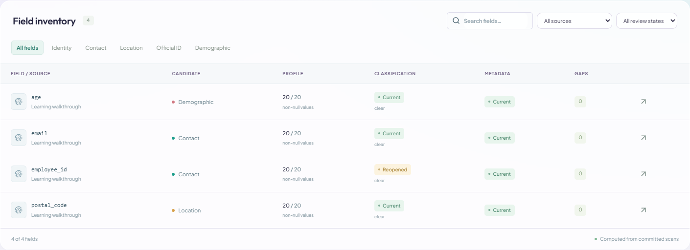
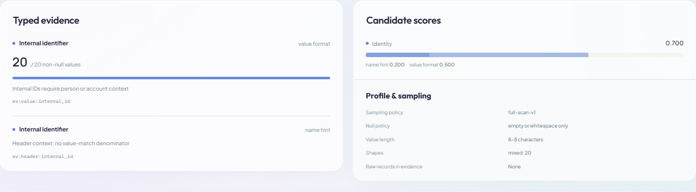
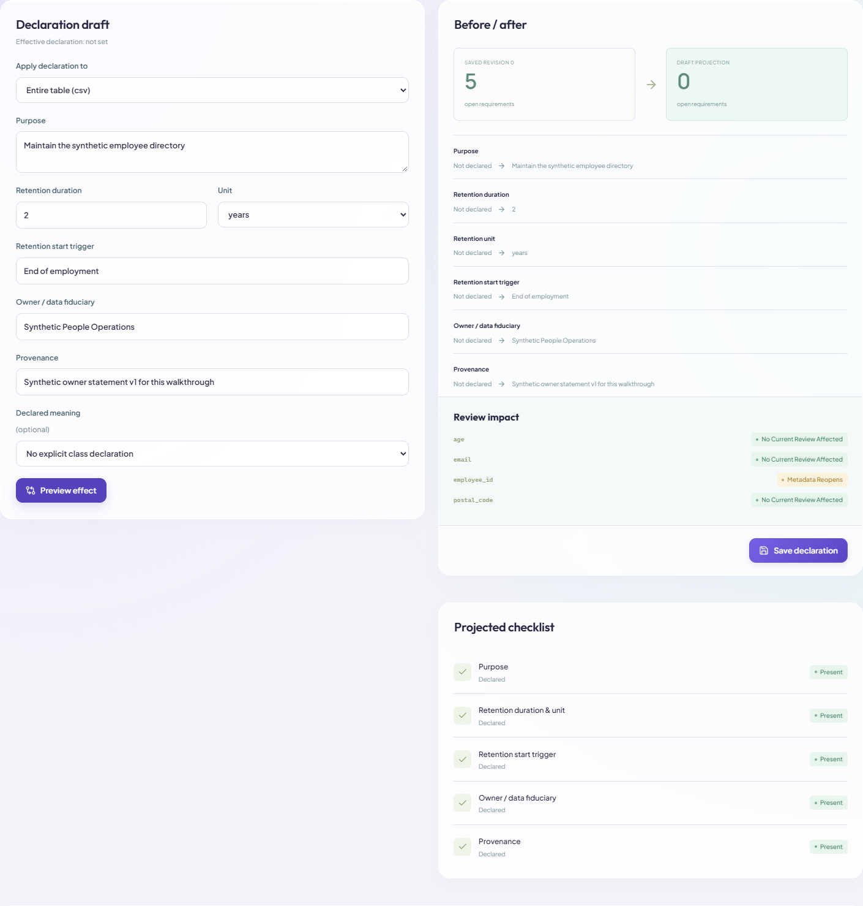
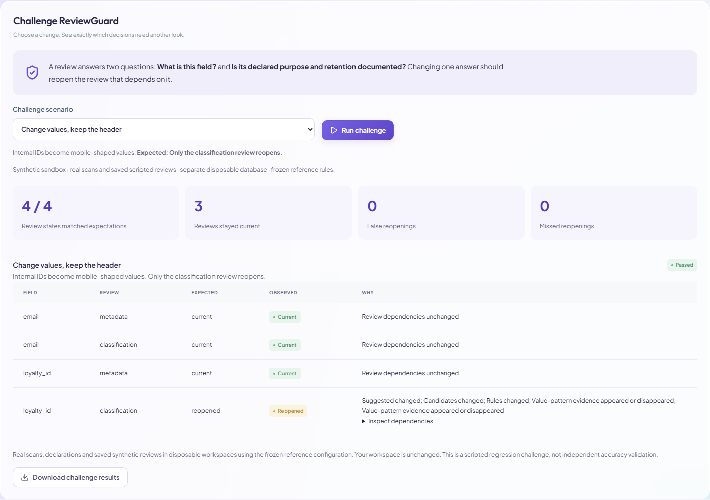

# PrivacyTwin

**Find personal data. Keep its evidence current.**

PrivacyTwin scans CSV files and SQLite databases, explains candidate personal-data fields, and connects them to owner-declared purpose and retention. **ReviewGuard** keeps classification and metadata reviews separate: when evidence changes, the affected review reopens with a reason.

For example, an `employee_id` column changes from internal IDs to phone-shaped values. Its classification review reopens; its unchanged metadata review and the other fields' reviews stay current.



_Actual application screenshot using synthetic data. Candidate labels, review states and counts come from committed scans._

**Start here:** [Install and build](docs/BUILD.md) · [User guide](docs/USER_MANUAL.md) · [42-screenshot walkthrough](docs/walkthrough/WALKTHROUGH.md) · [Judge guide](docs/JUDGES_GUIDE.md) · [Reports](#reports-and-demonstration)

## Start the app

You need **Python 3.11+**, **Node.js 20.9+**, and npm. Microsoft Edge is needed only for the documented browser tests and screenshot capture. Gemini is optional; scanning, manual review and the demonstration work without an API key.

From PowerShell:

```powershell
git clone https://github.com/niveditapalanisamy/Privacy_Twin.git
cd Privacy_Twin
py -m venv .venv
.\.venv\Scripts\python.exe -m pip install -r requirements-lock.txt
cd web
npm ci
cd ..
powershell -ExecutionPolicy Bypass -File .\Start-PrivacyTwin.ps1 -Build
```

Open **http://127.0.0.1:3000**. The launcher starts the frontend and local backend in the background. Logs are in `data/runtime/`.

```powershell
# Start an already-built app
.\Start-PrivacyTwin.ps1

# Stop the app
.\Stop-PrivacyTwin.ps1
```

After changing application code, stop the app, then run `Start-PrivacyTwin.ps1 -Build`. See [build instructions](docs/BUILD.md) for development, other operating systems, tests and troubleshooting.

## Use it in seven steps

| Screen        | What to do                                                          | What you get                                                     |
| ------------- | ------------------------------------------------------------------- | ---------------------------------------------------------------- |
| **Sources**   | Upload a CSV or SQLite file → **Register & scan**                   | Actual source, table and field profiles                          |
| **Rules**     | Inspect or edit detectors and required metadata                     | Versioned rules and checklist                                    |
| **Inventory** | Open a field and inspect evidence                                   | Candidate classes, detector counts and competing interpretations |
| **Reviews**   | Save classification and metadata decisions separately               | Reviewer, rationale and original evidence dependencies           |
| **Metadata**  | Enter purpose/retention → **Preview effect** → **Save declaration** | Declared context, provenance and visible gaps                    |
| **Changes**   | Select the same registered source and upload a replacement          | Precise review reopening with before/after reasons               |
| **Results**   | Inspect findings, evaluate and export                               | Inventory, gaps, history, reports and portable evidence          |

Try [walkthrough_v1.csv](docs/examples/walkthrough_v1.csv), then replace it with [walkthrough_v2.csv](docs/examples/walkthrough_v2.csv). They contain 20 synthetic records and four fields; V2 changes only `employee_id`. Follow the [user guide](docs/USER_MANUAL.md) for exact clicks and expected results.

**Learn the states:** a _candidate_ is a scanner suggestion; _current_ means review dependencies are fresh; _clear/unresolved_ is the review outcome; _reopened_ means another review is needed. Complete metadata and a ready field describe technical workflow conditions, not legal compliance.

## What makes PrivacyTwin useful

| Feature                      | Why it matters                                                                                                                                                          |
| ---------------------------- | ----------------------------------------------------------------------------------------------------------------------------------------------------------------------- |
| **ReviewGuard**              | Reopens decisions whose dependencies changed and preserves unrelated reviews. Renames create new identities; restoring old values does not silently reapprove a review. |
| **Evidence experiments**     | Remove header hints, value patterns, declared meaning or checksum validation and compare the finding without changing saved decisions.                                  |
| **India-focused validation** | Includes Indian mobile patterns, PAN format, Aadhaar-shaped values with Verhoeff checks, and GSTIN checksum evidence. Matches remain candidates requiring context.      |
| **Metadata preview**         | Shows missing purpose, retention duration/start trigger, owner and provenance before saving. Field declarations explicitly override table defaults.                     |
| **Portable verification**    | Export a package with aggregate snapshots, original review dependencies, policies and a standalone score verifier.                                                      |
| **Optional AI assistance**   | Generate attributed proposals with evidence/revision checks, selectable confidence thresholds and accept/reject/revoke controls.                                        |

### Inspect the evidence



The interface shows numerators, denominators and score contributions. Scores are weighted evidence, not probabilities. Correlated signals are capped within each group.

<details>
<summary><strong>Screenshot: metadata preview and review impact</strong></summary>



Preview is read-only. Saving checks the draft and current revisions before committing the declaration.

</details>

<details>
<summary><strong>Screenshot: executable ReviewGuard challenge</strong></summary>



**Changes → Challenge ReviewGuard** runs eight scenarios using real scans and scripted reviews in separate disposable workspaces. The measured reference run matched **33/33 expected review states**, with **0 false and 0 missed reopenings**. These are scripted regression results.

</details>

## Optional real AI review

Set `GEMINI_API_KEY` on the backend, or put the key in the ignored local file `data/gemini-key.txt`. Keep credentials out of browser variables and Git. Restart the backend after changing its environment.

Open **Results / Scan report → Review automation**. Select a source, draft or automatic mode, scopes, maximum fields and minimum model confidence. The app offers **70%, 80%, 90%, 95% and 100%**; its general default is 95%. Each run saves the selected threshold. A clear proposal at exactly the threshold qualifies only if the other local checks pass.


In the documented **real Gemini run at 70%**, three synthetic fields produced **6 proposals: 2 automatically applied and 4 unresolved/pending**. All 15 missing metadata items remained flagged. The guide also verifies acceptance, rejection, revocation and reopening after a value change. The first connection failure and original 95% run are preserved as reference evidence.

- [Read the live-review record and screenshots](docs/ai-live/REVIEW.md)
- [Open the live-review PDF](docs/ai-live/Actual-AI-Review-70-Percent.pdf)
- [Inspect the actual provider result](docs/ai-live/downloads/provider-run-result.json)

The configured integration uses `gemini-3.1-flash-lite`. Real runs contact Google and consume provider quota. They send aggregate evidence and metadata completeness; field names are opt-in. Raw source rows and declaration text stay local. Model confidence is not measured accuracy. Mixed evidence and missing business declarations remain unresolved.

## Reports and demonstration

| Audience                 | Start with                                                                                                                                                                                                                                        |
| ------------------------ | ------------------------------------------------------------------------------------------------------------------------------------------------------------------------------------------------------------------------------------------------- |
| **Judges**               | [Judge guide](docs/JUDGES_GUIDE.md), [seven-slide pitch PDF](docs/submission/PrivacyTwin-Pitch.pdf), [five-minute script](docs/PITCH.md)                                                                                                          |
| **New users**            | [User guide](docs/USER_MANUAL.md), [42-screenshot tour](docs/walkthrough/WALKTHROUGH.md), [printable walkthrough PDF](docs/walkthrough/PrivacyTwin-Full-Walkthrough.pdf)                                                                          |
| **Technical reviewers**  | [Architecture](docs/ARCHITECTURE.md), [technical report draft PDF](docs/submission/PrivacyTwin-Technical-Report-Draft.pdf), [implementation audit](docs/IMPLEMENTATION_AUDIT.md)                                                                  |
| **Results and evidence** | [Verification record](docs/submission/VERIFICATION.md), [class metrics](docs/submission/evaluation-results.json), [ReviewGuard results](docs/submission/challenge-results.json), [synthetic evidence ZIP](docs/submission/synthetic-evidence.zip) |
| **Submission team**      | [Annotation and organizer checklist](docs/EVALUATION_PROTOCOL.md)                                                                                                                                                                                 |

The standalone HTML guides are also committed under `docs/walkthrough/` and `docs/ai-live/`. GitHub displays HTML as source; download those files and open them locally for clickable, enlarged screenshots. Combined download archives can be regenerated with the documented packaging tools.

From **Results**, download the final review report as HTML and use **Print / Save as PDF**. Inventory and gap reports are CSV; the passport and history are JSON. The evidence ZIP includes a standard-library verifier:

```powershell
python tools/verify_evidence.py docs/submission/synthetic-evidence.zip
```

This checks file consistency, references and aggregate score replay. Hashes do not establish authenticity or legal validity.

## Validation

| Check                              | Verified result                                             |
| ---------------------------------- | ----------------------------------------------------------- |
| Backend tests                      | **42 passed**                                               |
| Browser workflows                  | **9 passed**; the standard suite skips the opt-in live test |
| Production build                   | **Passed**, including TypeScript                            |
| Separate real Gemini review at 70% | **Passed**, with 14 actual screenshots                      |
| ReviewGuard challenge              | **33/33** expected states matched across 8 scenarios        |

```powershell
.\.venv\Scripts\python.exe -m pytest -q
cd web
npm run build
npm run test:e2e
```

Browser tests use Microsoft Edge, isolated ports and separate databases. See [BUILD.md](docs/BUILD.md#tests-and-verification) for details and the explicit opt-in command for real-provider testing.

The bundled detection evaluation contains **12 benchmark fields and 7 separate stress fields**, authored as synthetic regression data. It reports per-class precision, recall and support, plus three baseline variants. **Independent human-labelled held-out validation remains required** before claiming general detection accuracy.

## Scope and storage

- Five configured classes: **Identity, Contact, Location, Official ID and Demographic**.
- Local, single-user prototype. Workspace state is `data/workspace.sqlite3`; controlled source copies are in `data/uploads/`. Both are ignored by Git.
- Input limits: 10 MB per source, 20,000 rows per table, 100 columns, 25 SQLite tables and 250,000 cells per source. Admitted rows are scanned in full.
- Persisted field evidence contains aggregates. Uploaded source copies, declarations, field names and reviewer text can still be sensitive.
- The deterministic core works without an external provider. Optional Gemini review uses an external service.
- Technical evidence for human review: no automatic lawful-basis decision, legal compliance finding or universal data-flow inference.

PS-019 also requires organizer-specific repository/report deliverables. The [submission checklist](docs/EVALUATION_PROTOCOL.md) records the remaining human annotation, taxonomy confirmation and official-template work.
