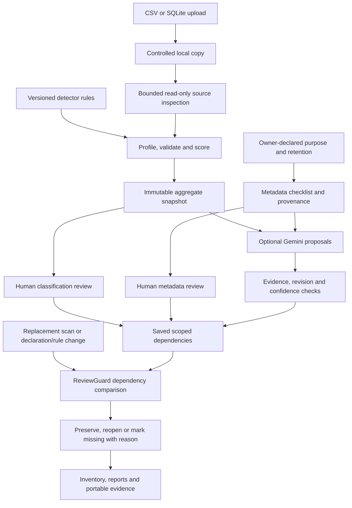

# Architecture and data flow

[README](../README.md) · [Build instructions](BUILD.md) · [Judge guide](JUDGES_GUIDE.md)

PrivacyTwin is a local, single-user application. A Next.js interface calls a FastAPI service through a local proxy. The Python core scans structured sources, calculates aggregate evidence and stores versioned reviews in SQLite. Optional Gemini assistance proposes decisions through that same review workflow.

## End-to-end flow

## Modules

| Module                                         | Responsibility                                                                                              |
| ---------------------------------------------- | ----------------------------------------------------------------------------------------------------------- |
| `web/app/`                                     | Seven-step interface, field evidence, reviews, preview, changes, insights and exports                       |
| `main.py`                                      | API routes, input validation, upload bounds and response handling                                           |
| `core/adapters.py`                             | CSV parsing and read-only SQLite table inspection                                                           |
| `core/engine.py`                               | Configurable detectors, grouped scores, checksum validation, checklist, sensitivity and semantic comparison |
| `core/service.py`                              | Registration, scans, exact field identity, declarations, review lifecycle and transactional revision checks |
| `core/storage.py`                              | SQLite schema, immutable records, append-only events and database transactions                              |
| `core/challenge.py`                            | Eight real lifecycle scenarios in disposable workspaces                                                     |
| `core/evaluation.py`                           | Measured field-class metrics, baseline comparisons and scope replay                                         |
| `core/ai_review.py`                            | Provider requests, structured-output validation, run controls, proposal actions and AI attribution          |
| `core/insights.py` / `core/report.py`          | Current-state findings and consistent-snapshot reports                                                      |
| `core/package.py` / `tools/verify_evidence.py` | Portable evidence ZIP and independent standard-library score replay                                         |

## Scan and evidence

Source inspection preserves exact table/column identities and important representations such as leading zeros. Each admitted field is scanned in full within limits: 10 MB, 20,000 rows per table, 100 columns, 25 SQLite tables and 250,000 cells per source.

Rules can use header hints, full-value patterns, normalization and structural/checksum validation. Each class's evidence takes the strongest contribution within a signal group, then applies the configured group weights. Duplicate rules within the same group therefore do not independently accumulate score. Candidate classes, near ties, mixed evidence and unknown states remain inspectable.

Snapshots store aggregates, detector counts/denominators, candidate contributions and relevant rule revisions. Checksum-rejected format counts are retained with zero validated strength, allowing format-only experiments. A checksum or format match is candidate evidence, not proof of issuance, ownership or personal/business linkage.

## Two review scopes

| Scope          | Relied-on inputs                                                                                                      | Example reopening                               |
| -------------- | --------------------------------------------------------------------------------------------------------------------- | ----------------------------------------------- |
| Classification | Candidate interpretations, relevant rules, scoring/materiality policies and evidence; declared meaning when relied on | Internal IDs become mobile-shaped values        |
| Metadata       | Explicit declarations, checklist and resolver policy                                                                  | Purpose removed or retention declaration edited |

Reviews save the original snapshot and dependency projection with reviewer and rationale. ReviewGuard compares these with current dependencies. A new timestamp alone is irrelevant. A rate change is material according to the configured tolerance and sample-size policy; new interpretations and changed relied-on rules can still reopen a review independently of rate tolerance.

Renaming a column without an explicit identity mapping creates a new field; the old field is marked missing. A returning field's review reopens. An already-reopened decision never silently returns to current after value reversion. Failed scans preserve the last committed inventory.

## Declarations and preview

The owner supplies purpose, retention duration/unit/start trigger, owner and provenance. Field-level declarations completely override table defaults. Missing properties in a field override remain gaps rather than silently inheriting values.

Preview calculates checklist differences and affected reviews without a write. Saving requires the matching draft digest and current snapshot/declaration/policy revisions in a transaction. A stale browser draft cannot overwrite newer evidence; the UI keeps the rationale for explicit reinspection.

## Optional AI review

The server sends selected aggregate evidence and metadata presence states to the configured Gemini API. Raw source rows and declaration text are excluded; field names are opt-in. The provider key stays on the backend. Detector identifiers and aggregate metadata can still reveal information.

Structured decisions must cover the requested field/scope pairs and cite known evidence. Clear classification requires supported unambiguous evidence. Missing metadata forces unresolved results. Automatic application additionally requires confidence **at least** the selected threshold and current revisions. Current decisions are protected. The UI offers 70%–100%, with a general default of 95%; the documented live review selected 70%.

AI-applied and user-approved AI reviews are explicitly attributed. A later rescan uses the same ReviewGuard logic as a human-origin decision. Reject creates no review; revoke supersedes an applied review. Provider quota/failure states preserve progress for deliberate action without automatic retry or model fallback.

## Read-only experiments and reproducibility

The evidence workbench recalculates the selected snapshot using its frozen weights/threshold. Removed signals are not redistributed. It does not mutate configuration, snapshots or reviews. Older snapshots need rescanning for complete validation details.

The challenge creates separate temporary databases and source copies. Expected per-scope states are specified before observed states are compared. This is executable regression evidence, separate from classification evaluation.

The export package reads one database transaction and includes original dependencies, policies, declarations, aggregate snapshots, inventory/gap/history reports and evaluation if present. The included verifier checks file hashes, policy identifiers, dependency references and independent candidate-score replay. Without an externally trusted signature, internal hashes do not establish authenticity.

## Evaluation boundary

Per-class precision/recall/support are calculated from supplied field labels. The built-in set contains 12 benchmark fields and 7 separate stress fields. The header-only baseline gives headers weight 1; the pattern baseline removes Aadhaar/GSTIN checksum validation; full validation uses the saved policy. The exact method is recorded alongside results.

This is developer-authored synthetic regression data. Independent manual annotation, frozen held-out evaluation and the selected five-class taxonomy need separate confirmation. No general real-world accuracy or legal compliance claim follows from these checks.
