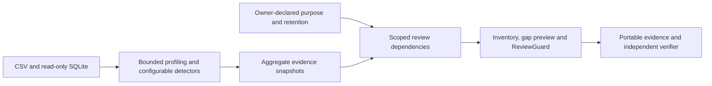

# PrivacyTwin — five-minute pitch

**Find personal data. Keep its evidence current.**

**One sentence:** PrivacyTwin finds candidate personal data in CSV and SQLite sources, connects each field to its declared purpose and retention, and reopens a human review when the evidence it relied on changes.

## 0:00–0:30 · The problem

“This field was reviewed yesterday. Today the values changed, but the column name stayed the same. Can we still rely on yesterday’s decision?

Teams collect spreadsheets and database tables faster than they document them. They lose track of which fields may contain personal data, why they hold them, and what their retention declarations say.”

## 0:30–1:15 · Find and explain

Load the synthetic workspace in Sources. Show that it contains three CSVs and one SQLite database. Open Inventory, then customers.csv / contact_value.

“PrivacyTwin scans the actual files and builds a field inventory across five configured classes. Here, the same field contains email-shaped and mobile-shaped values. We show the detector counts and their denominators, rather than hiding the mixture behind a label.”

On this fixture the ordinary scan computes 32 email matches and 18 mobile matches out of 50 non-empty values. Verify those counts on screen before speaking them.

## 1:15–2:00 · Question the evidence

Open **What supports this finding?** Turn off Header hints and click Compare evidence.

“A judge should be able to question the result. Remove the column-name hints and the value evidence still supports Contact. Remove the value patterns as well and the scanner abstains. These are calculations using the saved evidence; the experiment does not change any decision.”

Explain scores as weighted evidence, never a probability. If demonstrating checksums, use the explicitly invalid-checksum cases in the evaluation rather than claiming all numeric strings are Aadhaar numbers.

## 2:00–3:20 · The signature demonstration

Open Changes / Challenge ReviewGuard. Select **Change values, keep the header** and run it. Expand the observed states and changed dependencies.

“We save two separate reviews: what the field represents, and whether its declared metadata has been reviewed. In this sandbox, we replace internal identifiers with mobile-shaped values and rescan through the real scanner. The classification review reopens. The metadata review and the unrelated email reviews remain current.”

Then select **Change an unrelated rule**, run it, and show all reviews remain current. If time permits, let a judge choose another scenario.

“The question is not just whether something changed. It is whether the change affects the decision we already made.”

The challenge uses scripted synthetic reviewer actions in disposable databases. Say this clearly. For a longer mentor session, demonstrate the same loop with an actual human save in the normal workspace.

## 3:20–4:10 · Close a documentation gap

Open a field / Declaration & preview. Enter a purpose, retention duration and unit, owner, and provenance. Preview with the start trigger blank, then add “Account closure” and preview again.

“A duration by itself leaves a missing start trigger. The preview shows which documentation gaps close before anything is saved. The owner supplies the business declaration; PrivacyTwin reports what is present and what is missing.”

Save after preview. Show the gap report. Do not call a complete checklist legal compliance.

## 4:10–5:00 · Prove and close

Open Exports & evaluation, Run evaluation, and show the baseline comparison plus stress errors. Use the currently generated results, including failures. The bundled set contains 12 benchmark fields and 7 separate stress fields. It is developer-authored synthetic regression data; independent human-labelled validation remains a submission task.

Download the Reproducible evidence package. Explain that the included standalone verifier checks hashes, dependency references and aggregate score replay without a model API.

“We can show what was observed, how a candidate was scored, what a reviewer decided, and why that decision later needed another look. PrivacyTwin finds personal data and keeps its evidence current.”

## Architecture in plain language

Next.js presents the workflow. FastAPI coordinates the modular Python core. SQLite stores immutable evidence snapshots, versioned declarations and review events. Classification and metadata reviews record different dependencies. Optional Gemini assistance sits outside the deterministic core and is unnecessary for this demo.

## Concise answers for judges

**What is your contribution?** A working evidence-to-review lifecycle, demonstrated through selective reopening, sensitivity experiments and reproducible aggregate scoring. We do not claim personal-data detection itself is new.

**How do you evaluate it?** Per-class precision, recall and support; the same inputs across three explicitly described baselines; separate difficult-case errors; and eight real lifecycle scenarios. Independent human-labelled cases must be collected before claiming held-out accuracy.

**Does the system know lawful purpose or valid retention?** The business owner declares those values. The application reports documentary gaps and technical observations for a human reviewer.

**What does offline mean?** The scanner, rules, reviews, challenge, evaluation and verifier run locally. Optional Gemini calls an external provider when explicitly used.

**Are hashes proof that the result is true?** They detect inconsistency within the package. They do not establish authenticity, issuance of an identifier, or legal validity.

**What remains?** Independently labelled evaluation, confirmation of the five-class taxonomy, the official report template, organizer repository workflow, and a recorded backup demo.

## Rehearsal checklist

- Use a clean, isolated demo workspace and the reference rules. Avoid resetting a working user database.
- Run all challenge scenarios before presenting. Review the actual measured results.
- Keep the deterministic workflow as the main presentation; optional provider availability must not gate the demo.
- Practice to 4:40, leaving 20 seconds for transitions. Record a backup of the completed flow.
- Fill team names and ownership details in the official submission. The provided problem statement references a separate report template that has not been supplied.
