# Actual AI review — 70% confidence cutoff

Captured 29 October 2026, 22:58 IST. Real provider: gemini-3.1-flash-lite. Simulation: false.

Run: `d2181d5e-34f3-4c1f-9b78-a5dc55319742`. Threshold: **70% inclusive**. Mode: automatic. Fields: 3. Scopes: classification and metadata. Field-name sharing: off.

The application supports selecting 70% for this review. The general default stays 95%. No evidence/ambiguity/metadata checks were relaxed. The cutoff is model-reported confidence, not classification accuracy.

Original 95% run: 0 automatically applied, 6 pending, 2180 reported tokens. This 70% run: 2 automatically applied, 4 pending, 2123 reported tokens. These are separate nondeterministic provider calls, not an accuracy experiment.

| Field | Scope | Outcome / class | Confidence | Immediately after AI | After review actions |
|---|---|---|---|---|---|
| contact_value | classification | unresolved | 45% | pending | pending |
| contact_value | metadata | unresolved | 100% | pending | pending |
| email | classification | Contact | 70% | applied | revoked / superseded |
| email | metadata | unresolved | 100% | pending | applied / current |
| employee_id | classification | Identity | 70% | applied | applied / reopened |
| employee_id | metadata | unresolved | 100% | pending | rejected |

Actual provider usage: {"candidatesTokenCount": 839, "promptTokenCount": 1284, "totalTokenCount": 2123}. All 15 metadata gaps remained after the review actions.

## Evidence

- Actual-AI-Review-70-Percent.html: self-contained screenshot guide.
- Actual-AI-Review-70-Percent.pdf: printable guide.
- run-summary.json: measured run, decisions, actions and checks.
- downloads/provider-aggregate-input.json: frozen aggregate input; no raw rows, field-name property or authentication header.
- downloads/provider-run-result.json: original completed provider run, before acceptance/rejection/revocation.
- downloads/report-before-revoke.html and .json: report with AI attribution before revocation.
- downloads/report-after-actions.html and .json: report after revocation and changed-value rescan.
- synthetic-live-input.csv: the synthetic source, retained locally for reproducibility.

## What the screenshots demonstrate

### 1. Choose the synthetic input

Twenty synthetic records contain three fields: email, employee_id and a mixed contact_value. No owner purpose or retention is declared. The source file stays local; the provider receives aggregate evidence instead of these rows.

Observed: Input selected; the source has not yet been registered.

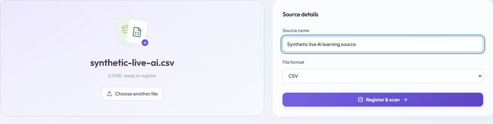

### 2. The deterministic scanner runs first

The ordinary scanner calculates candidate classes and evidence before any AI call. The mixed contact_value contains both email and mobile-shaped values. All three fields still need reviews and declared metadata.

Observed: 3 scanned fields; 15 missing metadata items; no saved reviews.

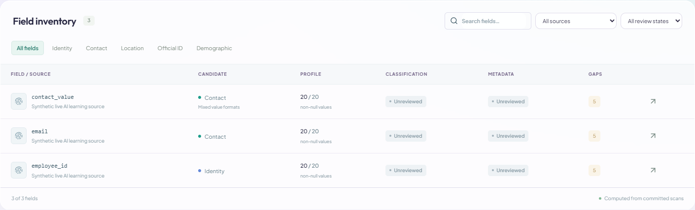

### 3. Configure this review at 70%

For this requested review, automatic mode allows locally validated clear proposals at or above 70% model confidence to apply. Both scopes are requested for three fields. Mixed evidence and missing metadata still require unresolved outcomes. Field-name sharing is off.

Observed: Actual Gemini API; maximum 3 fields; classification and metadata; confidence threshold 70% inclusive; field names off.

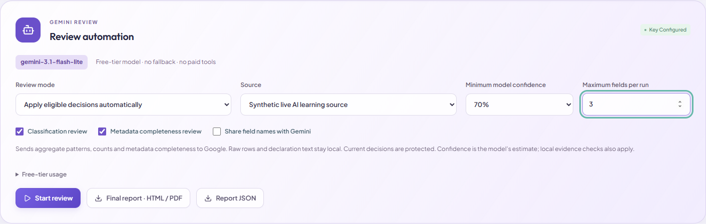

### 4. The server sends the aggregate evidence

The server freezes the selected evidence, snapshot references and review scopes. The real provider is called by the background worker. There is no simulated response or browser-route fixture in this capture.

Observed: Run d2181d5e-34f3-4c1f-9b78-a5dc55319742; 3 fields requested. The screenshot records the state at capture time.

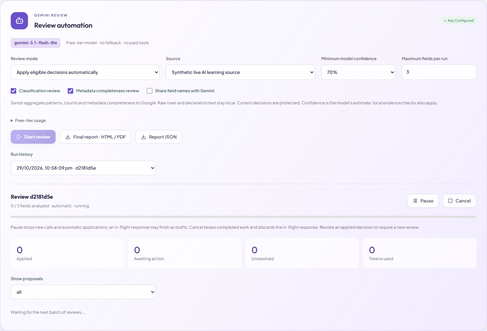

### 5. Inspect the actual completed run

The provider returned structured proposals. The backend checked the requested field/scope pairs, evidence references, ambiguity, metadata completeness and current revisions. Only eligible clear proposals were allowed to apply.

Observed: Actual result: 6 proposals; 2 applied; 4 pending; 4 unresolved; 2123 provider-reported tokens.

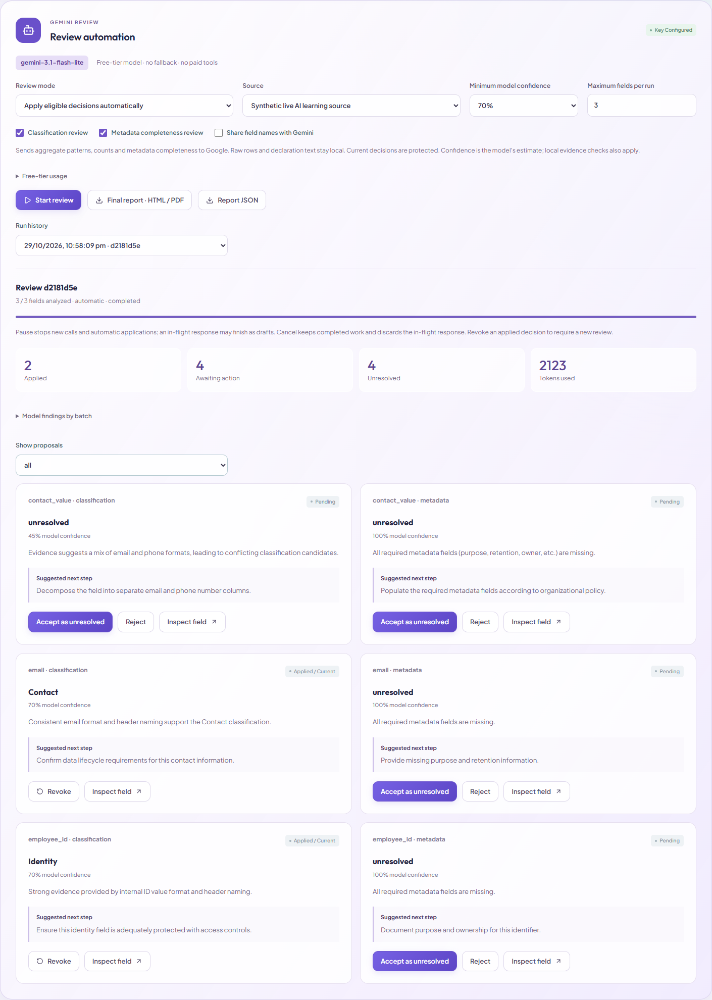

### 6. Read the email classification proposal

Read the model's actual rationale, cited class and confidence. Applied means a review was saved; pending means it still awaits action. The confidence is the model's self-assessment, not measured accuracy.

Observed: email classification: clear; applied; confidence 0.7.

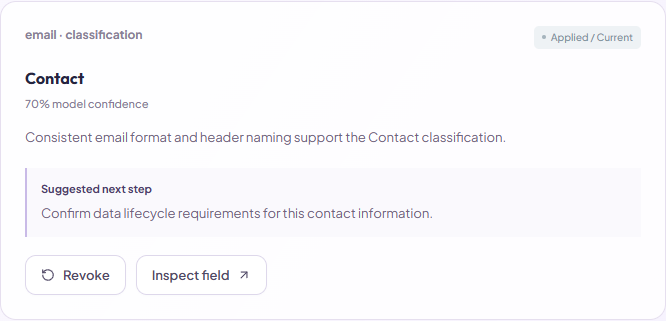

### 7. Missing documentation stays unresolved

The source has no declared purpose, retention, owner or provenance. AI can identify that gap and suggest a next step, but it cannot invent the business declaration. A high confidence in an unresolved outcome is not permission to mark it complete.

Observed: email metadata: unresolved; pending. Five metadata gaps remain for this field.

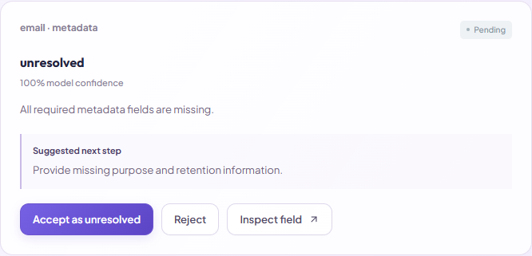

### 8. Mixed evidence needs clarification

contact_value has ten email-shaped and ten mobile-shaped values. The system preserves the mixed-field state. It does not allow an ambiguous/mixed field to become an automatically clear classification merely because the model sounds confident.

Observed: contact_value classification: unresolved; pending.

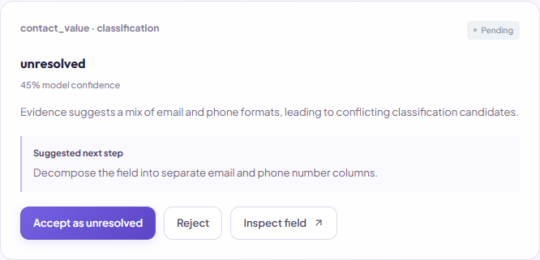

### 9. Applied AI decisions appear in the inventory

Current means the saved decision's dependencies are still fresh. Rows without applied decisions remain unreviewed. Metadata gaps stay visible regardless of whether classification was reviewed.

Observed: After the real run: 2 applied proposals; all 15 metadata gaps remain.

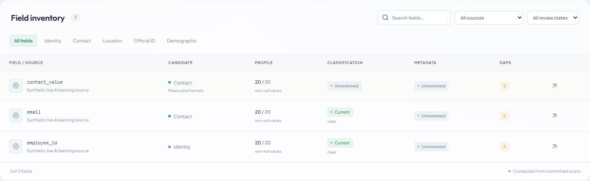

### 10. Accepting unresolved records the gap, not completeness

Accept as unresolved saves the AI-assisted metadata assessment. It is a current unresolved review, explicitly attributed to user-approved AI. It does not fill purpose or retention and does not make the field ready.

Observed: email metadata: applied / current, outcome unresolved. The five documentation gaps remain.

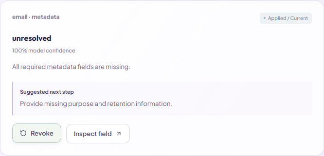

### 11. Reject a proposal without saving a review

Reject records the user's action on the proposal. It does not create a metadata review or remove documentary gaps. Existing current decisions are protected from AI overwrites.

Observed: employee_id metadata proposal: rejected; no metadata review was created for it.

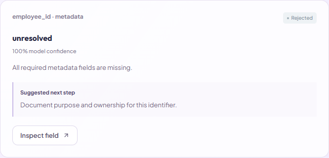

### 12. The report includes AI provenance and unresolved work

The actual report retains reviewer attribution, run information and proposal actions. Metadata gaps and unresolved outcomes remain visible. A report export does not approve a field.

Observed: Live run d2181d5e-34f3-4c1f-9b78-a5dc55319742 is included in report history. All three fields still have documentation gaps.

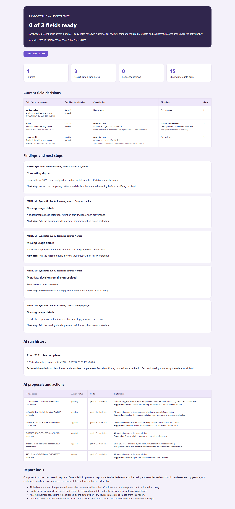

### 13. Revoke an applied AI decision

Revoke supersedes that applied AI review. It requires a fresh review and does not silently restore an earlier approval. The original proposal and action remain in the audit history.

Observed: email classification: revoked / superseded. No current classification decision remains for that field.

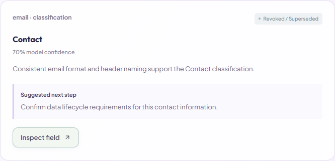

### 14. ReviewGuard also checks AI-origin decisions

Only employee_id values changed to phone-shaped numbers. Its saved AI-origin classification review now reopens through the ordinary dependency logic. Accepting AI output does not bypass later evidence checks. No second AI call was made.

Observed: employee_id now has a Contact candidate and a reopened classification review. email's revoked classification remains unreviewed.

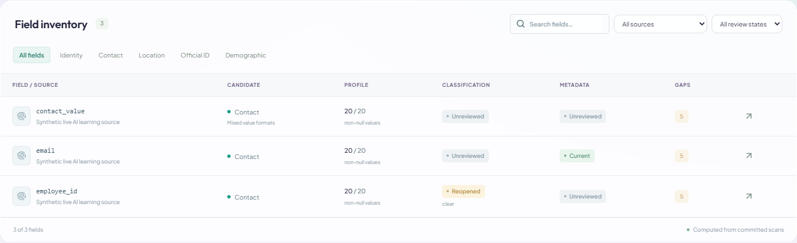

## Provider attempt record

A first 70% attempt (9bc769ec-a6ad-4492-90c4-21c02a002087) failed with: Gemini could not be reached or returned an unreadable response. Resume this run later. It produced no applied proposals. That record is preserved in references/failed-70-percent-attempt.json. A separate fresh test produced the completed run documented here. The application did not automatically retry or switch models.