# PrivacyTwin — full screenshot walkthrough

Captured 29 October 2026, 22:39 IST. All screenshots use an isolated synthetic workspace.

Open PrivacyTwin-Full-Walkthrough.html for the self-contained, clickable guide, or the PDF for a printable copy.

## 01. Start with an empty workspace

**What to click:** Open PrivacyTwin → Sources.

PrivacyTwin builds an inventory of fields, not just files. You supply synthetic CSV or SQLite data. No approvals or scan results exist until an action creates them.

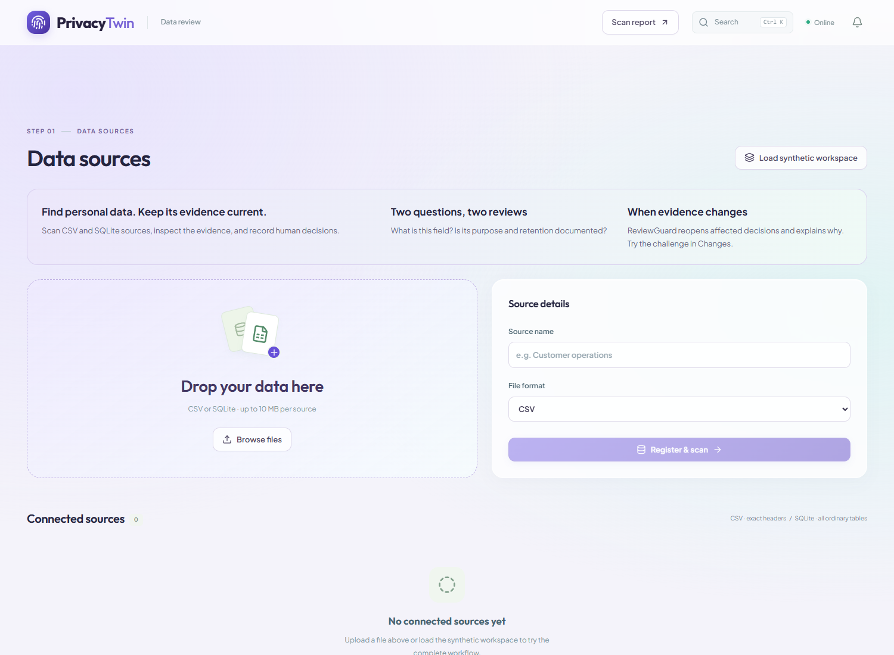

**Observed:** This isolated workspace has 0 sources and 0 discovered fields.

## 02. Choose a real input file

**What to click:** Sources → Upload source file → walkthrough_v1.csv → name it Learning walkthrough.

The sample contains 20 synthetic employees and four columns: employee_id, email, postal_code and age. Selecting a file is a draft; Register & scan commits the source and calculates evidence.

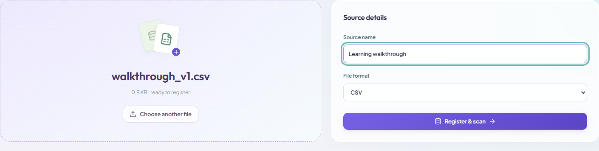

**Observed:** The chosen file is ready to register. It has not been scanned yet.

## 03. Registration produces a committed scan

**What to click:** Click Register & scan.

The scanner reads the actual source and stores aggregate counts and versioned evidence. It keeps a controlled local copy of the input. Twenty records produce four field profiles, not twenty findings.

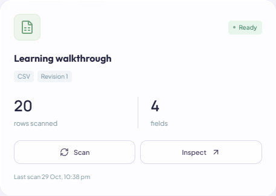

**Observed:** Observed: 1 CSV source, 20 rows, 4 discovered fields and no preloaded approvals.

## 04. Rules explain how findings are calculated

**What to click:** Rules / Configuration → inspect weights and thresholds.

The reference policy weights value patterns at 0.50, header hints at 0.20 and declared meaning at 0.30. A 0.25 acceptance threshold determines whether a candidate is suggested. These are configurable evidence weights, not probabilities.

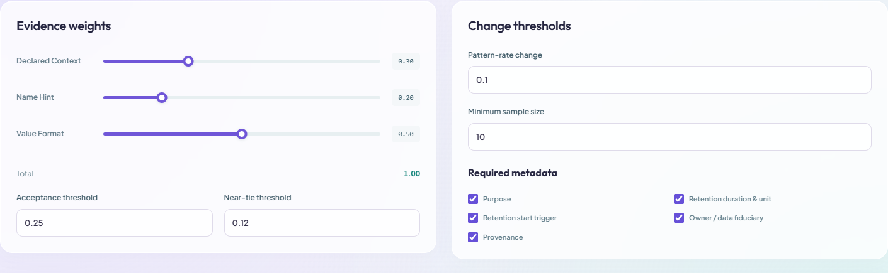

**Observed:** The walkthrough uses the saved reference policy. No configuration change is made here.

## 05. The checklist defines the required documentation

**What to click:** Configuration → Required metadata.

The checklist asks for purpose, retention duration/unit, a start trigger, an owner and provenance. Each is independently present or missing. A declaration can be complete without being a legal compliance finding.

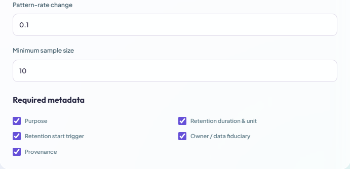

**Observed:** Five enabled requirements × four fields initially produce 20 metadata gaps.

## 06. Read the field inventory

**What to click:** Inventory → inspect the four rows.

employee_id is an Identity candidate, email is Contact, postal_code is Location and age is Demographic. The candidate is a scanner suggestion; the separate classification and metadata columns show human-review state.

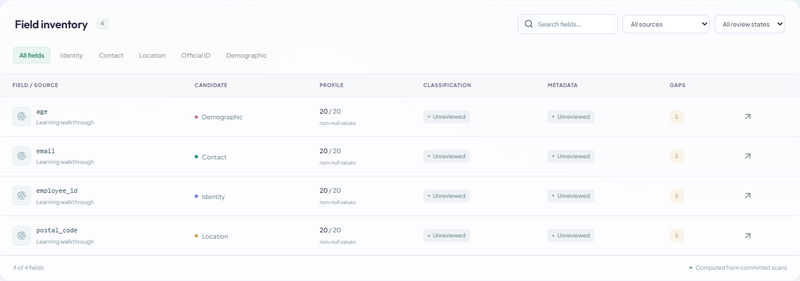

**Observed:** All four fields are unreviewed. Each has five missing metadata requirements.

## 07. Open the evidence behind one candidate

**What to click:** Inventory → employee_id → Evidence.

The internal-identifier rule matches all 20 non-empty values and the header provides a supporting hint. Grouped scoring yields 0.50 + 0.20 = 0.70. The interface shows counts and denominators, not raw rows.

**Observed:** employee_id: Identity candidate, score 0.700, 20/20 identifier matches.

## 08. Remove the header hint

**What to click:** Evidence → What supports this finding? → uncheck Header hints → Compare evidence.

The identifier values still support Identity after the name hint is removed. The score falls from 0.700 to 0.500 and remains above 0.25. This is a temporary calculation; no policy, snapshot or review is changed.

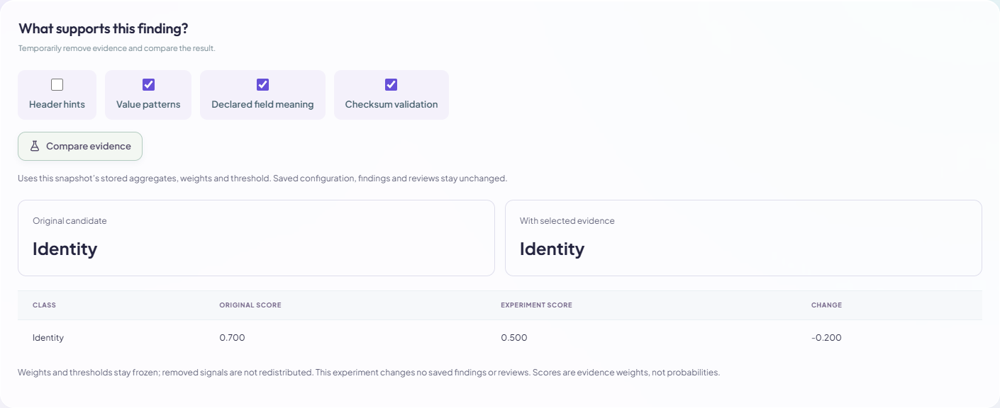

**Observed:** Original Identity 0.700 → experiment Identity 0.500.

## 09. Remove enough support and the scanner abstains

**What to click:** Also uncheck Value patterns → Compare evidence.

There is no declared meaning in this example. Removing headers and value patterns leaves no positive support. Abstained means there is insufficient evidence for a suggested class; it does not mean the field is safe or non-personal.

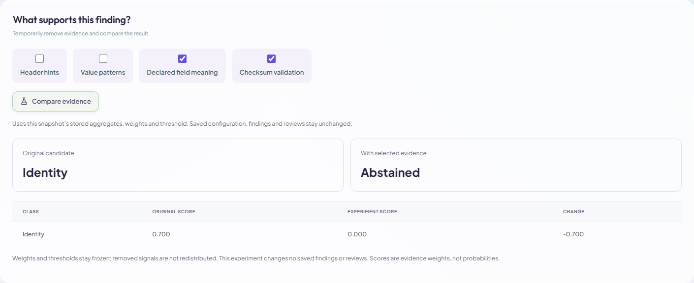

**Observed:** Original Identity → experiment Abstained. The saved finding remains Identity.

## 10. A human records a classification decision

**What to click:** Field → Review decision → Classification → enter reviewer and rationale.

The reviewer accepts an evidenced class and explains why. The saved decision records its original snapshot, policy and dependencies. This is a human judgement attached to evidence, not an automatic approval.

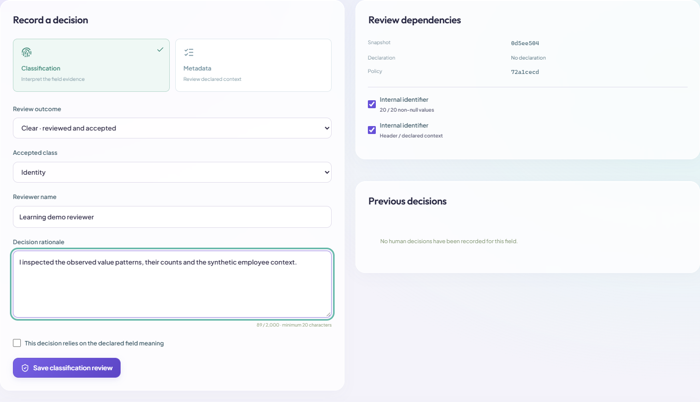

**Observed:** The form is ready to save Identity for employee_id.

## 11. Current and clear are different

**What to click:** Save classification → choose Metadata → mark Unresolved → save.

Current means the decision still matches its dependencies. An unresolved metadata decision can be current while saying that documentation is missing. Clear describes the review outcome; current describes freshness.

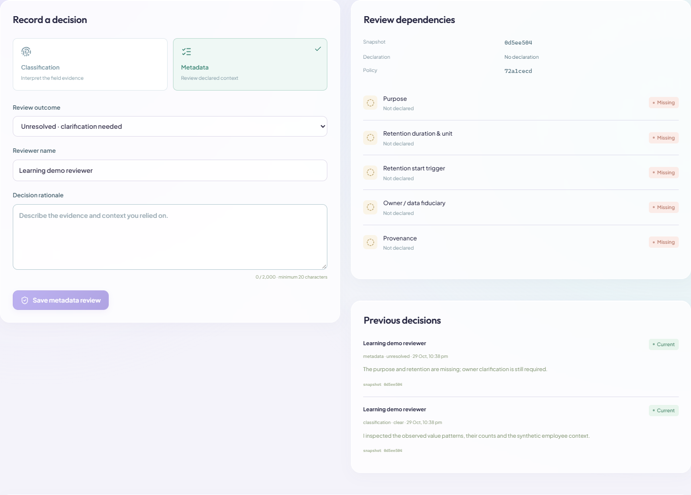

**Observed:** Classification: current / clear. Metadata: current / unresolved. Five documentation gaps remain for this field.

## 12. A duration without a start trigger stays incomplete

**What to click:** Declaration & preview → Entire table → enter purpose, 2 years, owner and provenance → Preview effect.

Two years from when? Leaving the start trigger blank leaves one requirement open for each field. A table declaration supplies a shared default to all four fields. A field-specific declaration would completely override that default.

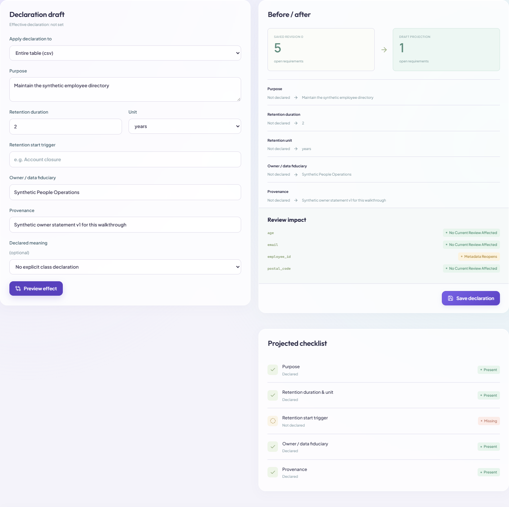

**Observed:** Preview: employee_id gaps 5 → 1. The database export before and after preview is identical.

## 13. Complete the declaration and inspect the review impact

**What to click:** Add Retention start trigger = End of employment → Preview effect.

The projected checklist is now complete. The preview identifies the metadata review affected by the proposed declaration change. Classification does not depend on purpose or retention in this example.

**Observed:** Preview: gaps 5 → 0 for employee_id. The employee_id metadata decision will reopen; its classification decision will stay current.

## 14. Saving changes the metadata dependency

**What to click:** Save declaration → Inventory.

The shared table declaration closes all 20 gaps. The previously saved employee_id metadata review reopens because its declaration changed. The classification review stays current. The other fields still need human reviews.

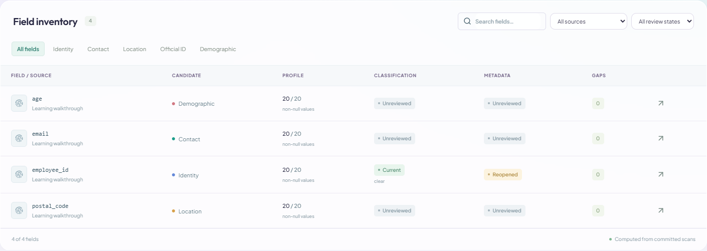

**Observed:** Four fields now have zero gaps. Exactly the saved metadata review reopens.

## 15. Complete reviews and documentation before calling a field ready

**What to click:** Review each field's classification and metadata → Results / Scan report.

All four fields now have current clear reviews and complete configured metadata. Ready describes this technical workflow state. It does not establish lawful purpose, lawful retention or legal compliance.

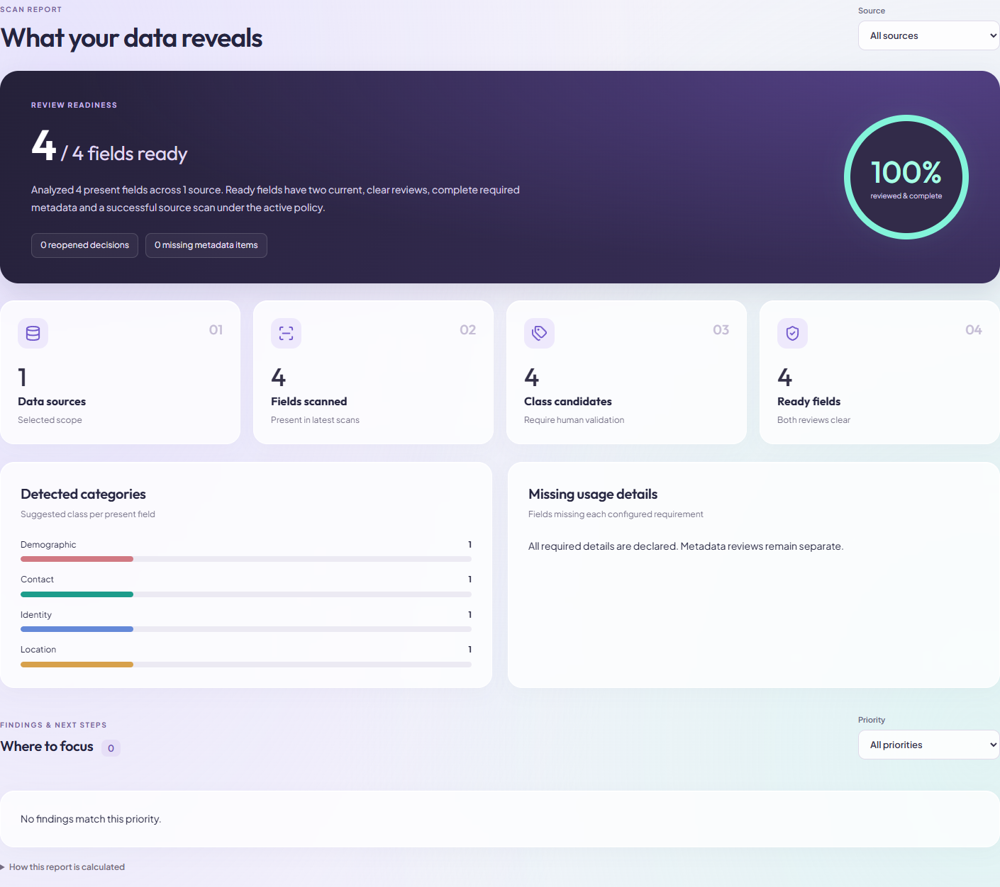

**Observed:** Observed: 4 of 4 fields ready, 0 metadata gaps, 0 reopened decisions.

## 16. Replace values while keeping field identity

**What to click:** Changes / ReviewGuard → Learning walkthrough → Replacement file = walkthrough_v2.csv.

V2 has the same headers and unchanged email, postal and age values. Only employee_id changes: internal IDs are replaced with mobile-shaped numbers. The exact field identity survives, so ReviewGuard can compare against its saved reviews.

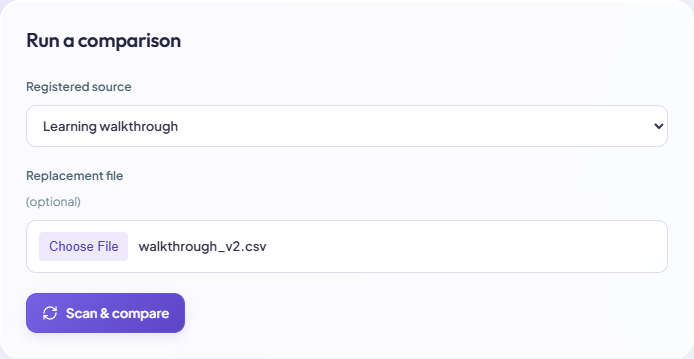

**Observed:** Replacement selected. No rescan has been committed yet.

## 17. Only the affected classification review reopens

**What to click:** Scan & compare → Inventory.

The new values support Contact despite the employee_id name. That changes the evidence behind the classification review. Its metadata declaration is unchanged, so that review stays current. Reviews on email, age and postal_code are preserved.

**Observed:** employee_id: Contact candidate, classification reopened, metadata current. One of eight saved scoped reviews reopens.

## 18. Compare actual old and new evidence

**What to click:** employee_id → Evidence → Snapshot comparison.

The previous snapshot has 20 internal-ID matches. The new snapshot has 20 Indian-mobile matches. Snapshots preserve the evidence that existed at scan time; opening an older snapshot does not restore its old approval.

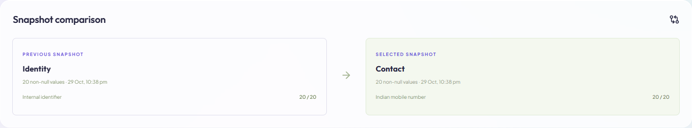

**Observed:** Previous Identity → selected Contact; both scans contain 20 non-empty values.

## 19. Read why a decision reopened

**What to click:** Field → Field history → expand changed dependencies.

History records the original decision and later state transitions. Changed candidate interpretations, relevant rules and detector counts explain this reopening. The original rationale and evidence reference remain attached to the review.

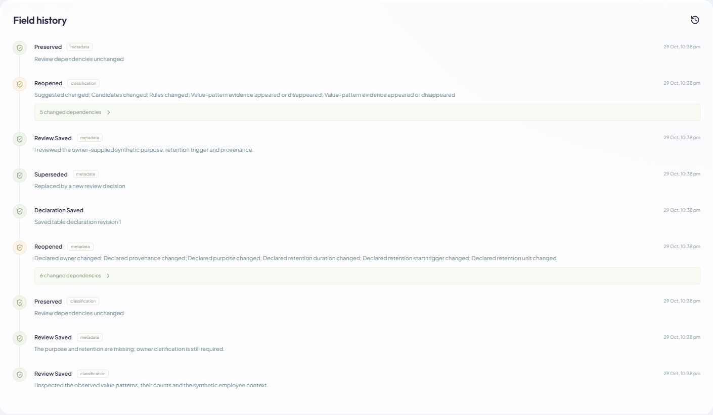

**Observed:** A classification reopening event includes explicit before/after dependencies.

## 20. Readiness falls for a specific reason

**What to click:** Results / Scan report after V2.

Three fields remain ready. employee_id needs a fresh classification decision because its evidence changed. Missing metadata and reopened reviews are different issues: this example has no metadata gaps.

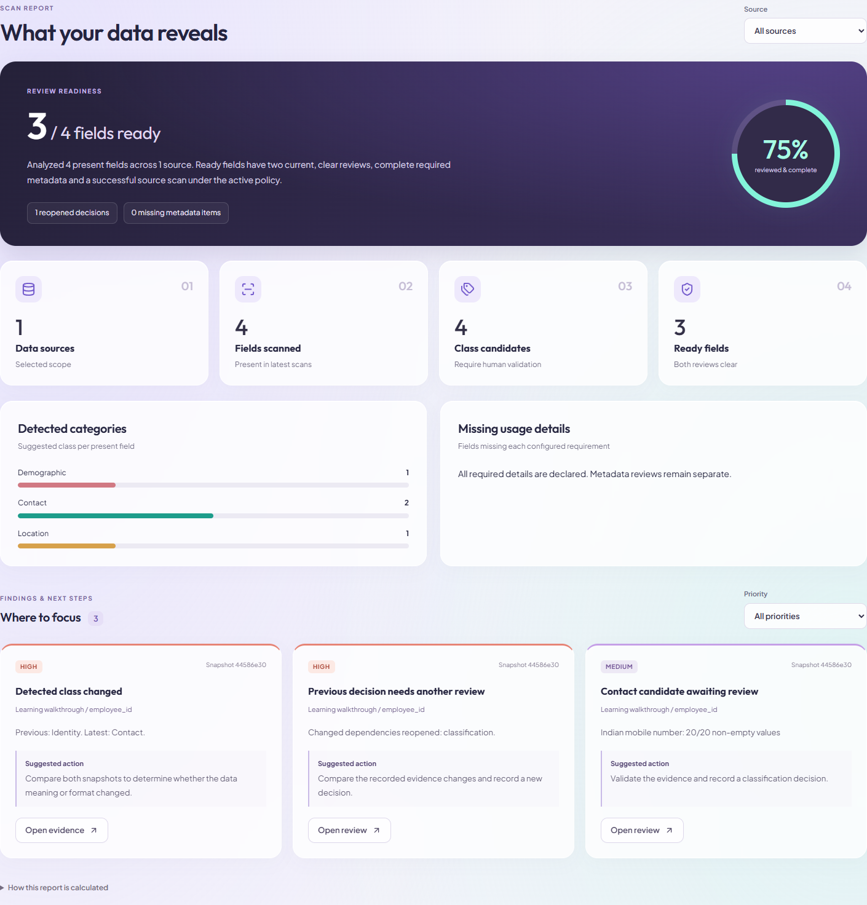

**Observed:** Observed: 3 of 4 fields ready; 1 reopened classification review; 0 metadata gaps.

## 21. Change values, keep the header

**What to click:** Changes → Challenge ReviewGuard → Change values, keep the header → Run challenge.

Internal-ID values become phone-shaped values. Classification depends on that evidence and reopens. Metadata remains current because its declaration is unchanged. Both email reviews are unrelated and remain current.

**Observed:** 4/4 expected review states matched: one classification reopened, three reviews current.

## 22. Remove the declared purpose

**What to click:** Changes → Challenge ReviewGuard → Remove the declared purpose → Run challenge.

The synthetic owner removes the declared purpose. This changes the metadata dependency, so the metadata review reopens. The field's observed values and classification evidence stay the same.

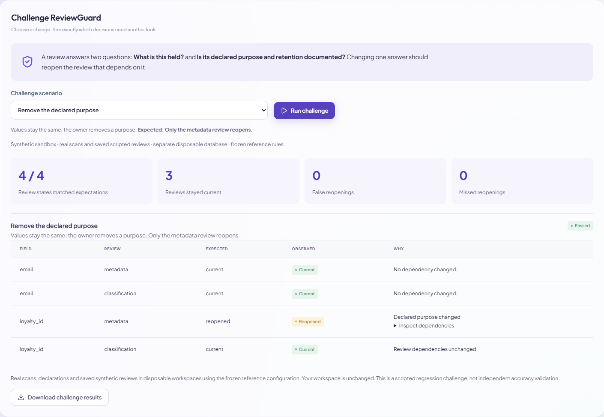

**Observed:** 4/4 matched: loyalty metadata reopened; loyalty classification and both email reviews current.

## 23. Change a relied-on rule

**What to click:** Changes → Challenge ReviewGuard → Change a relied-on rule → Run challenge.

The rule the classification relied on is edited so the original identifiers no longer satisfy it. Reusing the old classification decision would rely on changed logic. Metadata is unaffected.

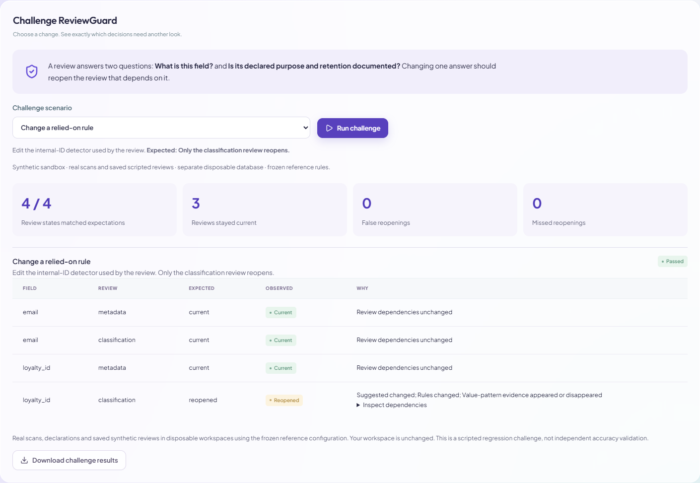

**Observed:** 4/4 matched: loyalty classification reopened; three other reviews current.

## 24. Change an unrelated rule

**What to click:** Changes → Challenge ReviewGuard → Change an unrelated rule → Run challenge.

The birth-date detector is edited. Neither of these fields relied on that detector. A global policy version change alone should not reopen their classification or metadata reviews.

**Observed:** 4/4 matched: all four reviews remain current.

## 25. Rescan identical data

**What to click:** Changes → Challenge ReviewGuard → Rescan identical data → Run challenge.

A rescan produces new scan identifiers and timestamps, but the semantic evidence is identical. Fresh timestamps alone do not invalidate a review.

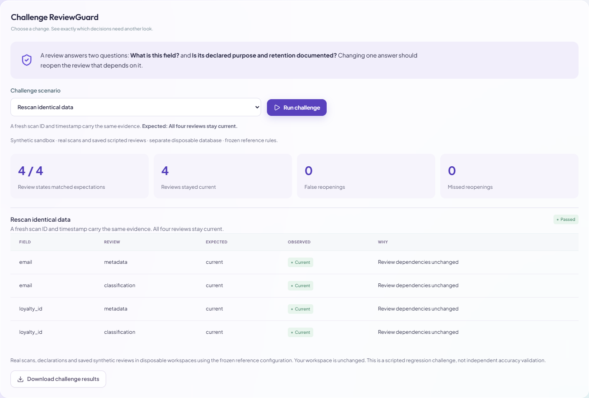

**Observed:** 4/4 matched: all four reviews remain current.

## 26. Rename without a mapping

**What to click:** Changes → Challenge ReviewGuard → Rename without a mapping → Run challenge.

loyalty_id is replaced by member_reference without an explicit mapping. The old field becomes missing. The new name is a new field identity with no copied approvals. Unrelated email reviews stay current.

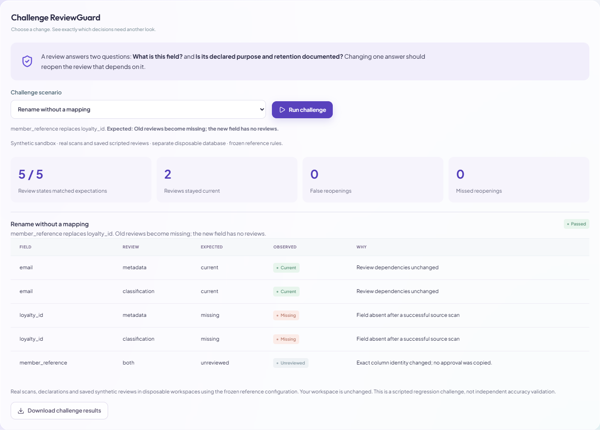

**Observed:** 5/5 matched: two old reviews missing, new field unreviewed, two email reviews current.

## 27. Change values, then restore them

**What to click:** Changes → Challenge ReviewGuard → Change values, then restore them → Run challenge.

Values change and reopen classification, then the original values are restored. ReviewGuard does not silently reapprove a reopened decision. A human must inspect and save a fresh review. Metadata and unrelated email reviews remain current.

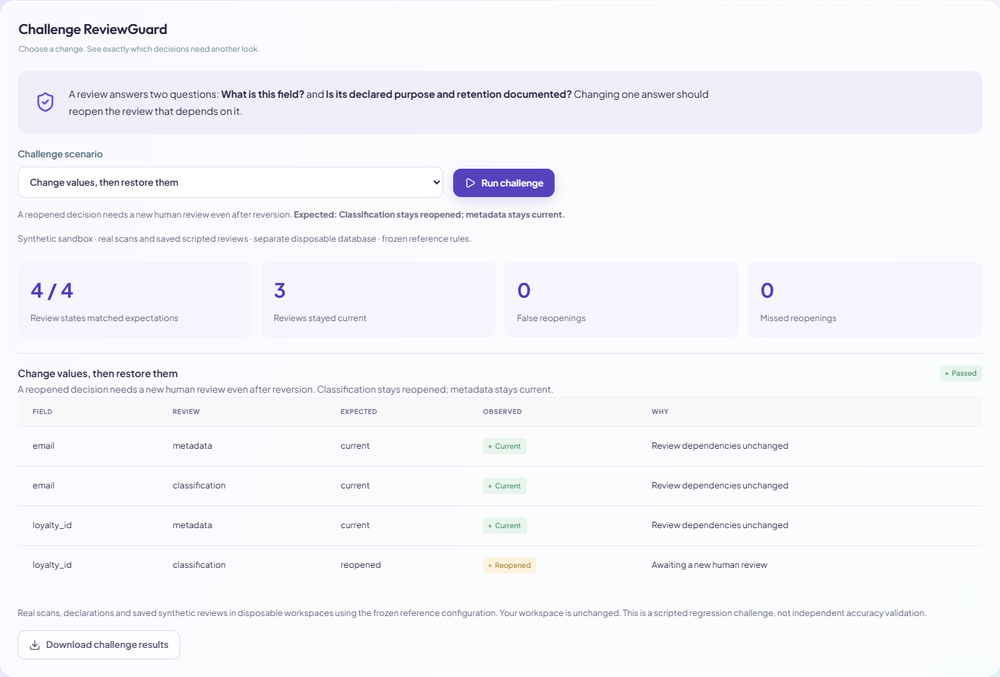

**Observed:** 4/4 matched: classification remains reopened after restoration; other reviews current.

## 28. Stay within the rate tolerance

**What to click:** Changes → Challenge ReviewGuard → Stay within the rate tolerance → Run challenge.

One of 50 identifiers becomes unrecognised, reducing the match rate from 100% to 98%. There is no new competing candidate, the denominator is sufficient and the rate change stays below the reference tolerance of 10 percentage points.

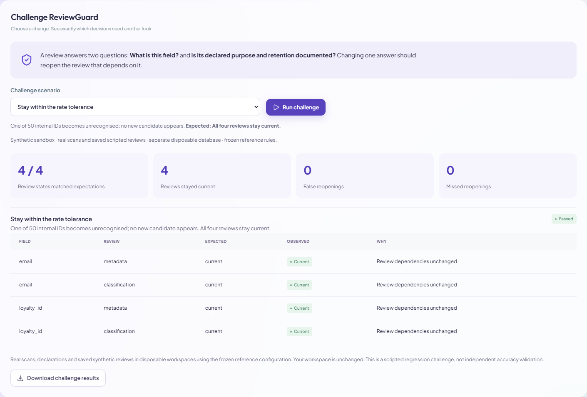

**Observed:** 4/4 matched: all reviews remain current. This is a configured tolerance, not a claim that every small change is harmless.

## 29. Compare the complete challenge results

**What to click:** Select Run all 8 scenarios → Run challenge.

Each scenario runs real Service scans, declarations and scripted saved reviews inside a disposable workspace. Its fixed reference policy is separate from your workspace configuration. The results are regression checks, not an independent accuracy estimate.

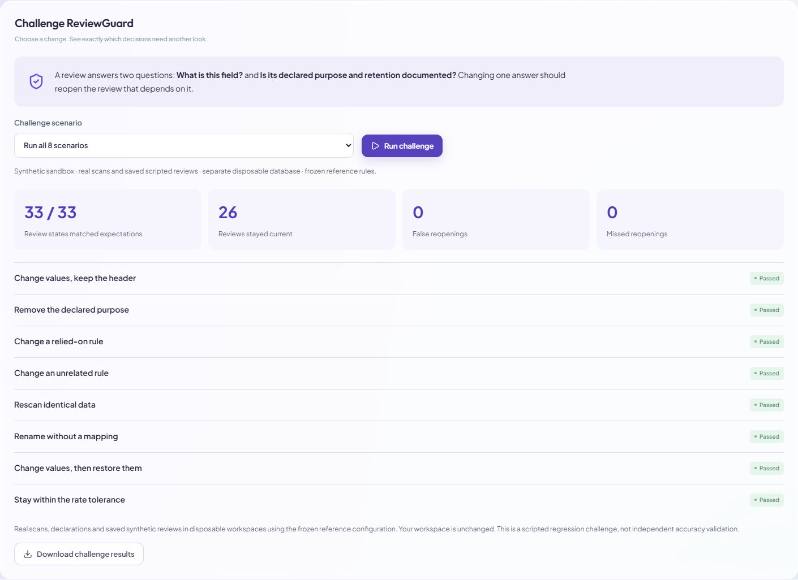

**Observed:** Observed: 33/33 states matched, 26 reviews stayed current, 0 false reopenings and 0 missed reopenings.

## 30. Read precision, recall and support

**What to click:** Results → Measured evaluation → Run evaluation.

Precision asks how many predicted positives were correct. Recall asks how many labelled positives were found. Support is the number of labelled positive fields. The bundled benchmark has just two positive fields per class; perfect scores here do not establish real-world accuracy.

**Observed:** Observed: 12 benchmark fields, 7 separate stress fields. This is developer-authored synthetic regression data, not independent human-labelled validation.

## 31. Measure what checksums contribute

**What to click:** Measured evaluation → Does validation help?.

All variants use the same labelled fields. The header-only baseline assigns weight 1 to headers. The pattern baseline removes Aadhaar/GSTIN checksum checks. Full validation uses the saved configuration. Stress errors reveal differences hidden by the easy benchmark.

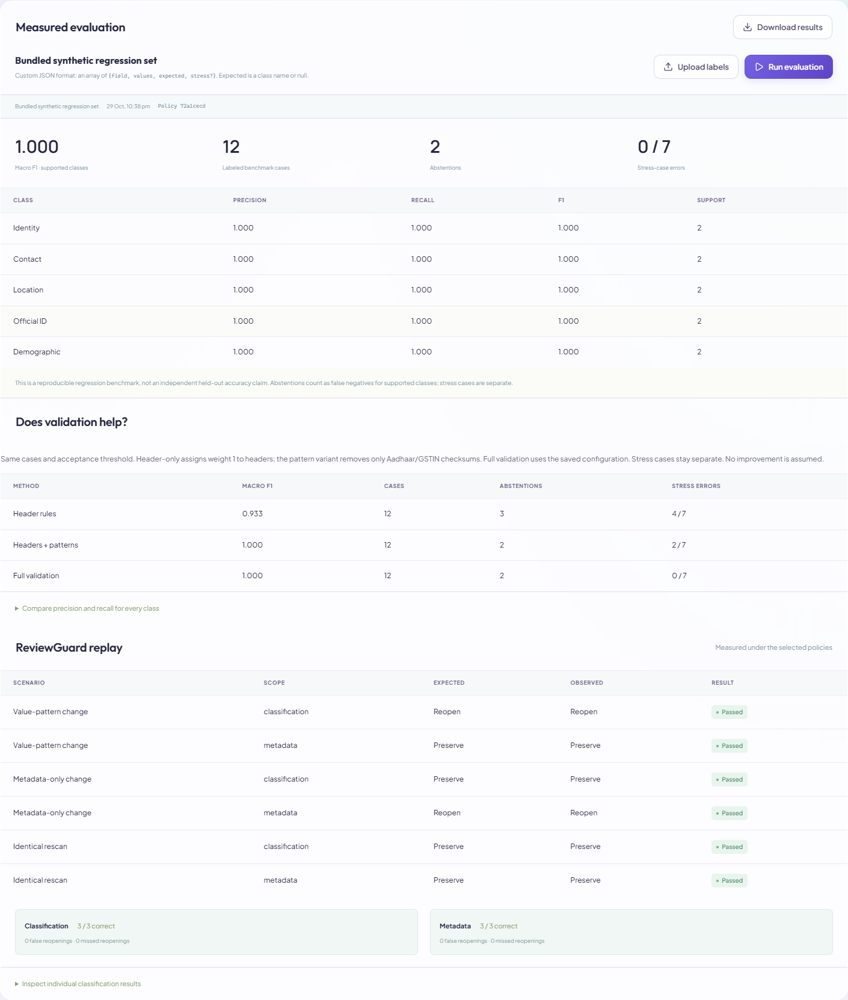

**Observed:** Measured stress errors: headers 4/7; headers + patterns 2/7; full validation 0/7. These are results on this small constructed set.

## 32. Download evidence and gap reports

**What to click:** Results → Exports.

Inventory CSV lists fields and scoped review states. Gaps CSV lists missing requirements. Passport JSON includes snapshots and dependencies. History preserves decisions and transitions. The ZIP combines these with a manifest and standalone verifier; raw source rows are excluded.

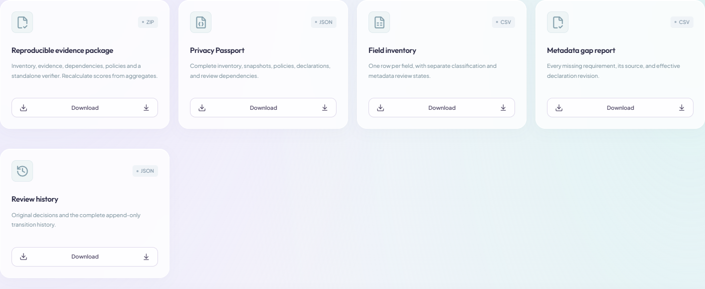

**Observed:** These exports reflect the current isolated walkthrough workspace, including the reopened employee_id review.

## 33. Open the final human-review report

**What to click:** Results → Final report · HTML / PDF → open the downloaded file.

The report contains actual field decisions, gaps, findings and AI provenance when present. Print / Save as PDF exports the report. A reopened review remains visible in the report; export does not approve it.

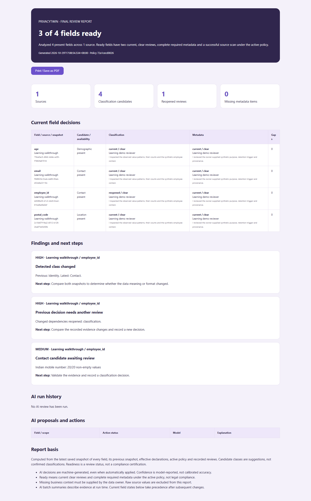

**Observed:** The report shows three ready fields and the reopened employee_id classification. No AI review was run.

## 34. Understand optional AI assistance

**What to click:** Results → AI review controls → inspect review mode, scopes and threshold.

Draft mode creates proposals for acceptance or rejection. Automatic mode can apply locally validated, sufficiently confident proposals while protecting current decisions. Pause, resume and cancel control a run; revoke supersedes an applied AI review. Model confidence is not calibrated accuracy. Missing owner declarations remain gaps.

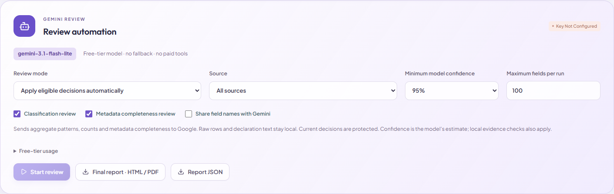

**Observed:** This screenshot shows idle controls only. No provider request, quota consumption or AI-generated decision is used in this walkthrough.

## 35. A stale review form cannot overwrite newer evidence

**What to click:** Open a review form → another scan changes its field → try Save classification review.

Another browser or action may change evidence while you are typing. Revision checks reject a save based on an old snapshot. The rationale is preserved. Reload data, inspect the changes, then explicitly choose Use latest evidence before saving.

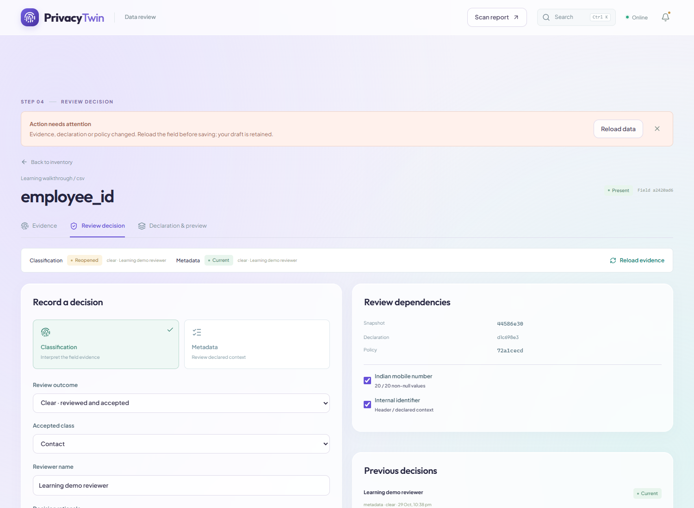

**Observed:** Observed: the stale save is rejected; the reviewer's rationale remains in the form.

## 36. A failed scan preserves committed evidence

**What to click:** Changes → select Learning walkthrough → upload a CSV with duplicate headers → Scan & compare.

Malformed replacement input is rejected instead of replacing the last valid inventory. The source is marked failed, and its prior committed snapshots and reviews remain available. Fix the input and rescan before treating the source as healthy.

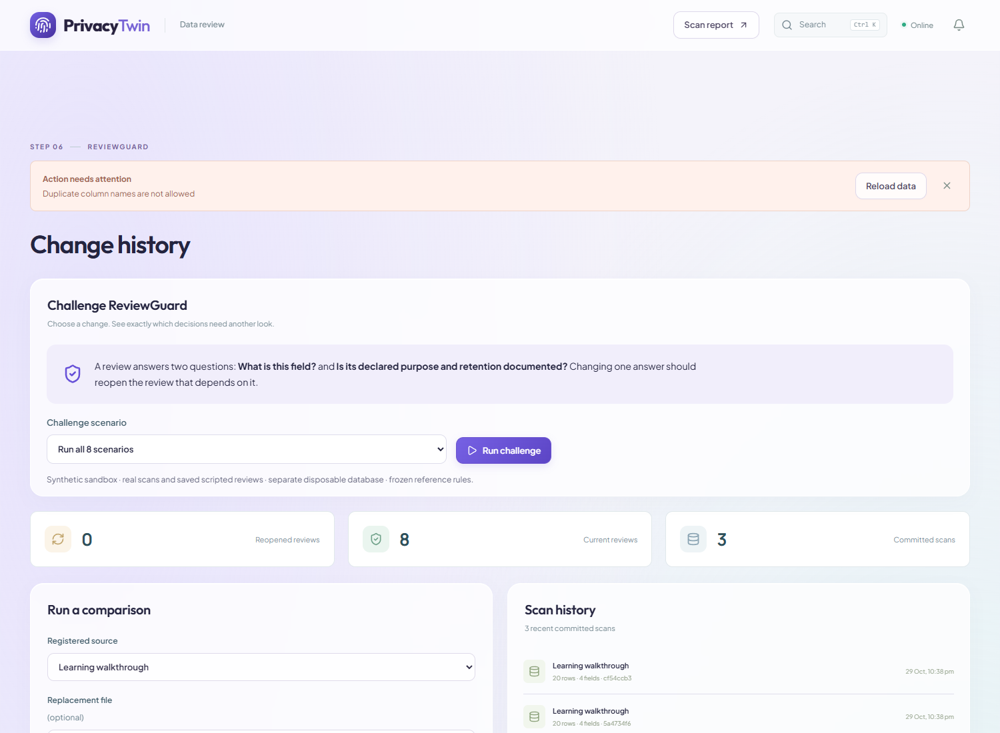

**Observed:** Observed: duplicate-header error. The previous four fields are preserved.

## 37. The same scanner also handles SQLite and mixed fields

**What to click:** Sources → Load synthetic workspace.

The built-in demo adds three generated CSVs and one SQLite database with two tables. They pass through ordinary scanning. This is additional data: the earlier four-field learning source remains, so combined workspace totals increase.

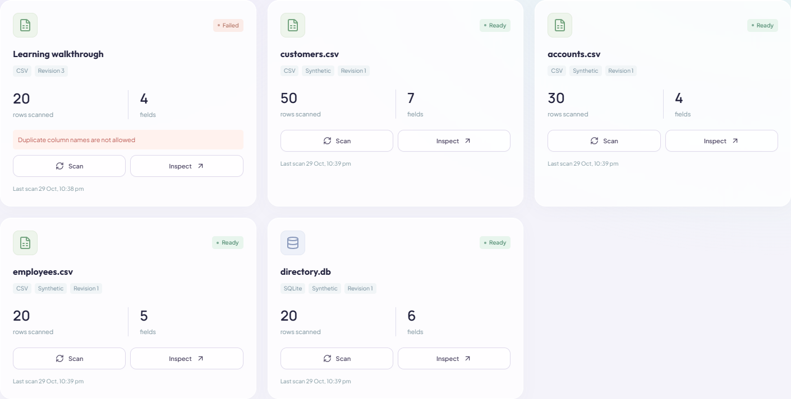

**Observed:** The workspace now contains the learning CSV plus four built-in synthetic sources. The SQLite source has contacts and offices tables.

## 38. A single field can contain several value types

**What to click:** Inventory → customers.csv / contact_value → Evidence.

A column does not always contain one uniform type. Here email and mobile detectors both contribute to the Contact class. The evidence retains their separate counts, while grouped scoring caps correlated evidence instead of adding every rule as independent support.

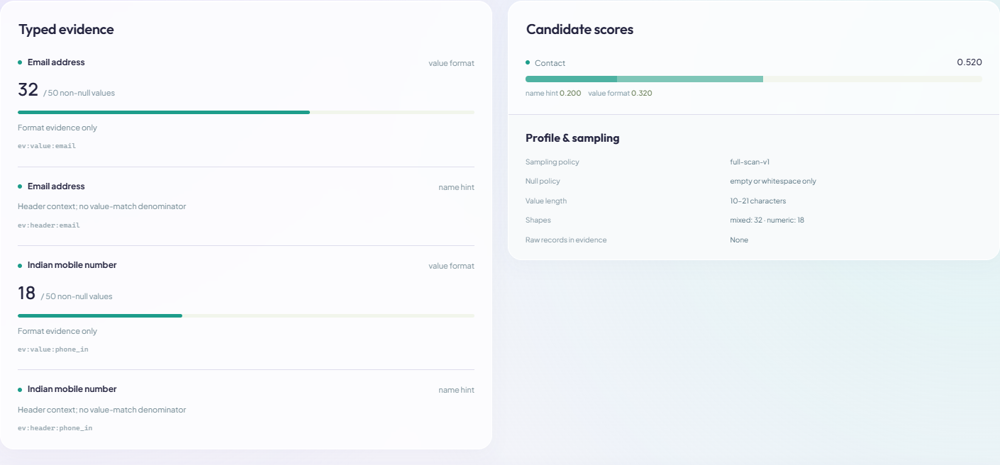

**Observed:** Measured on this synthetic source: 32/50 email matches and 18/50 mobile matches.

## 39. A checksum is stronger evidence than shape alone

**What to click:** customers.csv / ref_no → What supports this finding? → uncheck Checksum validation → Compare evidence.

A twelve-digit shape alone can create false positives. This synthetic field has 50 shape matches, of which 40 pass the configured Verhoeff check. Removing validation increases its evidence score. A checksum pass still does not prove issuance or identify a person.

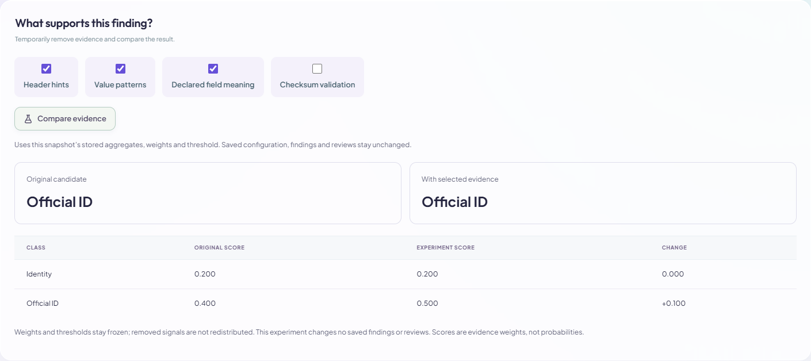

**Observed:** Official ID score 0.400 with checksum evidence → 0.500 using format matches alone.

## 40. An unknown pattern stays unknown

**What to click:** Upload codes.csv with ZX:1234 and ZX:5678 → Inventory → code.

The reference registry does not know this synthetic customer-code convention. The scanner leaves it without a suggested class. An owner or reviewer must supply context rather than treating every unfamiliar code as personal data.

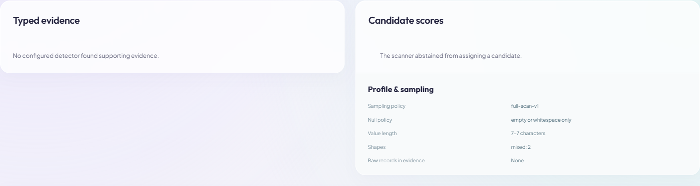

**Observed:** Before adding a rule: no supported candidate.

## 41. Add a domain-specific rule

**What to click:** Configuration → Add rule → set Identity, pattern ZX:[0-9]{4}, header code.

Rules describe the organisation's declared conventions. Full-value matching prevents a substring from accidentally matching. Saving a rule versions the policy; existing sources must be rescanned before new findings can be reviewed under it.

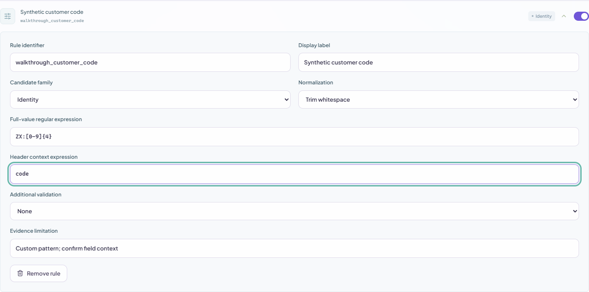

**Observed:** The synthetic custom rule is prepared in the editor; it has not yet changed scan results.

## 42. A rescan applies the saved rule

**What to click:** Save configuration → Sources → Custom codes / Scan → Inventory → code.

The rescan now observes two value matches and the supporting header. The field becomes an Identity candidate under the explicit synthetic rule. It still needs a human review and declared purpose/retention; a detector match is not an approval.

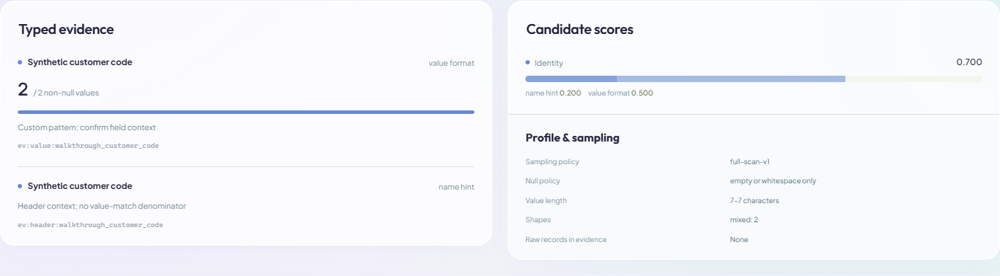

**Observed:** After the saved rule and rescan: Identity candidate, 2/2 matches, score 0.700.
